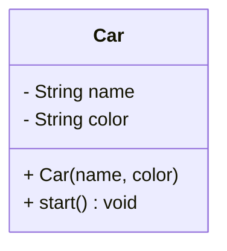

# Class and Object

Classes and objects form the foundational building blocks of Object-Oriented Programming (OOP). They provide the mechanism to translate real-world entities into modular, maintainable, and structured source code.

## Class

A **class** is a user-defined blueprint, template, or data type from which individual objects are created.

It establishes a contract defining what data an object will maintain and what behaviors it can perform.

A class defines two primary components:

- **Attributes (Fields/ State):** The structural variables that store the data or current state of the object.
- **Methods (Behaviors):** The functional blocks of code that operate on the state and define what the object can do.

Example:

```java
class Car {
    // Field or Attributes
    private String name;
    private String color;

    // Constructor
    public Car(String name, String color) {
        this.name = name;
        this.color = color;
    }

    // Method or Behavior
    public void start() {
        System.out.println(name + " has started.");
    }
}

```

UML Representation:



## Object

An **object** is a self-contained, concrete instance of a class that exists at runtime. While a class is a compile-time structural blueprint that consumes no memory space, an object is the live instantiation that allocates memory and holds real values.

**Instantiating Objects**

The `new` keyword is used to bring an object to life at runtime:

```java
public class Main {
    public static void main(String[] args) {
        // car1 and car2 are separate reference variables
        // pointing to distinct objects
        Car car1 = new Car("Toyota", "Red");
        Car car2 = new Car("Honda", "Blue");

        // Executing behaviors on the instances
        car1.start();
        car2.start();
    }
}

```

**Runtime Execution Mechanics**

Executing the statement `Car car1 = new Car("Toyota", "Red");` triggers a strict three-step sequence within the Java Virtual Machine (JVM):

1. **Allocation (Instantiation):** The `new` keyword instructs the JVM to allocate a block of memory dynamically inside the **Heap** region to house the object's instance data.
2. **Initialization:** The target constructor (`Car(...)`) is invoked immediately to assign the provided baseline arguments (`"Toyota"`, `"Red"`) to the newly allocated instance variables.
3. **Reference Assignment:** The memory address pointing directly to the heap object is bound to the stack reference variable (`car1`).

#### Deconstructing the Instantiation Syntax

```java
Car c1 = new Car("Toyota", "Red");
```

| Syntax Component       | Architectural Role         | JVM Execution Domain                                  |
| ---------------------- | -------------------------- | ----------------------------------------------------- |
| `Car`                  | **Data Type**              | Evaluated during compilation                          |
| `c1`                   | **Reference Variable**     | Allocated inside the local **Stack** frame            |
| `new`                  | **Allocation Operator**    | Instantiates raw memory layout inside the **Heap**    |
| `Car("Toyota", "Red")` | **Constructor Invocation** | Injects initial state attributes into the heap object |
