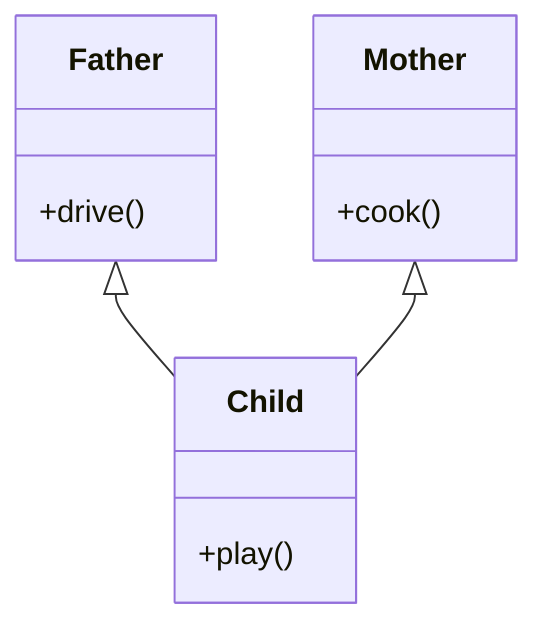
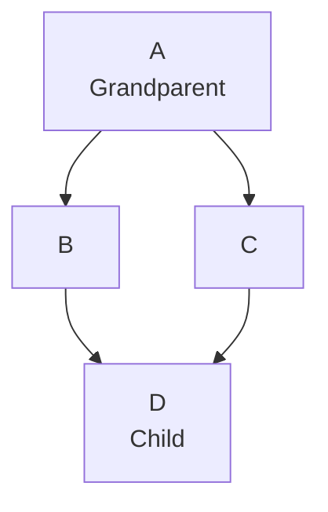

# Inheritance

Inheritance is one of the core principles of Object-Oriented Programming (OOP). It allows a class (subclass or child class) to acquire the properties and behaviors of another class (superclass or parent class).

**In inheritance the child class can:**

- Use the fields and methods of the parent class
- Override parent class methods to provide a specific implementation
- Add its own additional properties and methods
- The child class represents an **IS-A** relationship with the parent class. This means the child class is a specialized type of the parent class and inherits its characteristics.

**Key Benefits of Inheritance**xxx

- **Code Reusability**: Avoids code duplication by reusing fields and methods of the parent class.
- **Improves Maintainability**: Reduces redundancy, making code easier to manage.
- **Enhances Extensibility**: New functionality can be added easily without modifying existing code.

### How to Implement Inheritance

#### 1. Create a Parent Class

The parent class contains common fields and methods.

```java
// Parent class
public class Animal {
    String name;

    void eat() {
        System.out.println(name + " is eating...");
    }
}
```

#### 2. Create a Child Class using `extends`

The child class inherits the properties and methods of the parent class.

```java
// Child class
public class Dog extends Animal {

    void bark() {
        System.out.println(name + " is barking...");
    }
}
```

#### 3. Use the Child Class

Now, let's create an object and use the inherited methods.

```java
public class Main {
    public static void main(String[] args) {
        Dog myDog = new Dog();
        myDog.name = "Buddy";

        myDog.eat();  // Inherited from Animal class
        myDog.bark(); // Defined in Dog class
    }
}
```

Output:

```
Buddy is eating...
Buddy is barking...
```

### Types of Inheritance

#### 1. Single Inheritance

A subclass inherits from one superclass.

```java
class Parent {
    void show() {
        System.out.println("This is the parent class");
    }
}

class Child extends Parent {
    void display() {
        System.out.println("This is the child class");
    }
}
```

#### 2. Multilevel Inheritance

A subclass inherits from another subclass, forming a chain.

```java
class Grandparent {
    void show() {
        System.out.println("Grandparent class");
    }
}

class Parent extends Grandparent {
    void display() {
        System.out.println("Parent class");
    }
}

class Child extends Parent {
    void print() {
        System.out.println("Child class");
    }
}
```

#### 3. Hierarchical Inheritance

A single parent class has multiple child classes.

```java
class Parent {
    void show() {
        System.out.println("Parent class");
    }
}

class Child1 extends Parent {
    void display() {
        System.out.println("Child1 class");
    }
}

class Child2 extends Parent {
    void print() {
        System.out.println("Child2 class");
    }
}
```

**Note:** Java **does not support multiple inheritance** (i.e., a child class inheriting from multiple parents) due to ambiguity problems.

#### 4. Multiple Inheritance

Multiple inheritance is an concept in which a single class inherits properties and methods from more than one parent class.

For example, suppose a class `Child` wants to inherit features from both `Father` and `Mother`.



One child class inherits from two parent classes.

**Example in C++**

C++ supports multiple inheritance.

```cpp
class Father {
public:
    void fatherSkill() {
        cout << "Driving" << endl;
    }
};

class Mother {
public:
    void motherSkill() {
        cout << "Cooking" << endl;
    }
};

class Child : public Father, public Mother {
};

int main() {
    Child c;
    c.fatherSkill();
    c.motherSkill();

    return 0;
}
```

Output:

```
Driving
Cooking
```

The `Child` class can access methods from both `Father` and `Mother` because it inherits from both classes.

**Why doesn't Java support multiple inheritance through classes?**

Java does not allow a class to extend multiple classes.

For example, this is invalid Java code:

```java
class Father {
    void show() {
        System.out.println("Father");
    }
}

class Mother {
    void show() {
        System.out.println("Mother");
    }
}

// Compilation error
class Child extends Father, Mother {
}
```

Java does not support this because of potential ambiguity and complexity, especially the **Diamond Problem**.

#### What is the Diamond Problem?

Suppose two parent classes inherit from the same grandparent class, and a child inherits from both parents.



Imagine class `A` defines a method called `display()`.

- Class `B` inherits `display()` from `A` and overrides it.
- Class `C` also inherits `display()` from `A` and overrides it.
- Class `D` inherits from both `B` and `C`.

Now, when you call `display()` on an object of `D`, which implementation should run: the one from `B` or the one from `C`?

The compiler needs a clear rule to resolve the conflict. Multiple inheritance can also create complications around duplicated base-class state and method resolution.

C++ supports multiple inheritance but provides rules and mechanisms for resolving such cases, including explicit qualification and virtual inheritance. Java's designers chose to avoid this complexity for classes.

#### How does Java achieve similar functionality?

Java supports:

- Single inheritance through classes: a class can extend only one class.
- Multiple inheritance of type through interfaces: a class can implement multiple interfaces.

For example:

```java
interface Father {
    void driving();
}

interface Mother {
    void cooking();
}

class Child implements Father, Mother {

    public void driving() {
        System.out.println("Driving");
    }

    public void cooking() {
        System.out.println("Cooking");
    }
}
```

Now the `Child` class can implement both capabilities.

```java
Child c = new Child();
c.driving();
c.cooking();
```

Output:

```
Driving
Cooking
```

Java allows this because interfaces primarily define contracts that implementing classes must fulfill. The class provides the actual method implementations.

One important detail: modern Java interfaces can also contain `default` methods with implementations. If two interfaces provide conflicting default methods with the same signature, the implementing class must resolve the conflict by overriding the method, unless an inheritance rule already determines which implementation wins.

### Method Overriding in Inheritance

Method overriding allows a child class to **redefine** a method from the parent class.

```java
class Animal {
    void makeSound() {
        System.out.println("Animal makes a sound");
    }
}

class Dog extends Animal {

    @Override
    void makeSound() {
        System.out.println("Dog barks");
    }
}
```

Usage

```java
public class Main {
    public static void main(String[] args) {
        Animal myAnimal = new Dog();
        myAnimal.makeSound();
    }
}
```

Output:

```
Dog barks
```

**The `super` Keyword in Inheritance**

The `super` keyword is used to **refer to the parent class**. It helps to:

- Call the parent class constructor.
- Access the parent class methods.
- Access the parent class properties or fields.

```java
class Animal {
    Animal() {
        System.out.println("Animal Constructor");
    }

    void makeSound() {
        System.out.println("Animal makes a sound");
    }
}

class Dog extends Animal {
    Dog() {
        super(); // Calls the parent class constructor
        System.out.println("Dog Constructor");
    }

    void makeSound() {
        super.makeSound(); // Calls parent method
        System.out.println("Dog barks");
    }
}
```

Usage:

```java
public class Main {
    public static void main(String[] args) {
        Dog myDog = new Dog();
        myDog.makeSound();
    }
}
```

Output:

```
Animal Constructor
Dog Constructor
Animal makes a sound
Dog barks
```