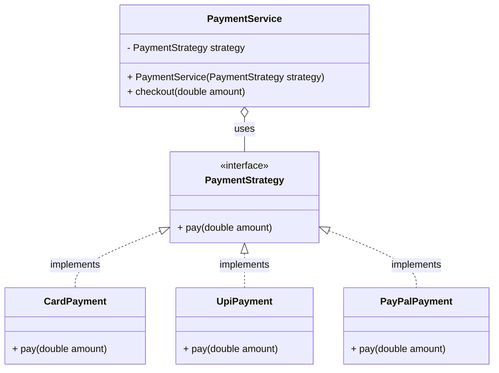
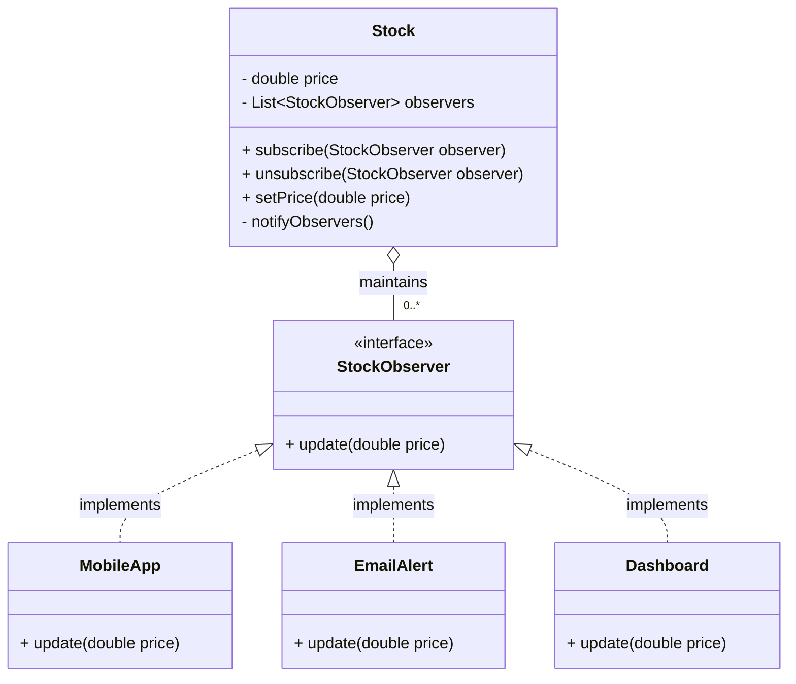
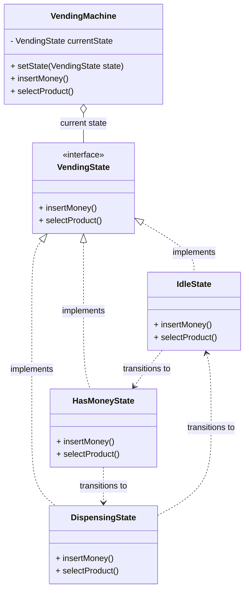
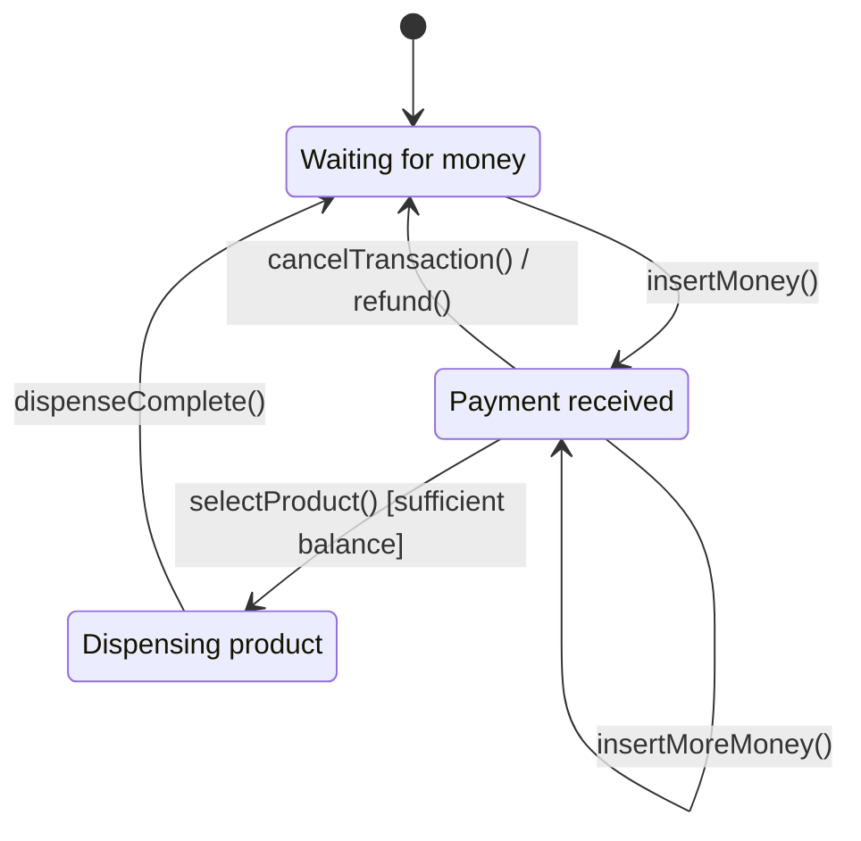

# Behavioural Design Pattern

A behavioral design pattern describes how objects communicate and share responsibilities with each other in software.

**Types of Behavioral Design Patterns**:

- [Strategy](#strategy-pattern) – Allows you to switch between different algorithms.
- [Observer](#observer-pattern) – Notifies multiple objects when one object changes.
- [State](#state-pattern) – Changes an object's behavior based on its current state.
- Command – Encapsulates a request as an object.
- Chain of Responsibility – Passes a request through a chain of handlers.
- Iterator – Accesses elements of a collection one by one.
- Mediator – Simplifies communication between multiple objects.
- Template Method – Defines the steps of an algorithm while allowing subclasses to customize some steps.
- Visitor – Adds operations to objects without changing their classes.
- Memento – Saves and restores an object's previous state.
- Interpreter – Defines rules for interpreting a language.

## Strategy Pattern

The Strategy Design Pattern lets you define multiple ways to perform an operation, put each way in a separate class, and switch between them without changing the code that uses them.

### Understand the problem first

Imagine you're building a payment system. Customers can pay using:

- Credit card
- UPI
- PayPal

A straightforward implementation might look like this:

```java
class PaymentService {
    public void pay(String method, double amount) {
        if (method.equals("CARD")) {
            System.out.println("Paying by card: " + amount);
        } else if (method.equals("UPI")) {
            System.out.println("Paying by UPI: " + amount);
        } else if (method.equals("PAYPAL")) {
            System.out.println("Paying by PayPal: " + amount);
        }
    }
}
```

This works, but there are problems:

- Every new payment method requires modifying `PaymentService`.
- The class accumulates conditional logic as new methods are added.
- Testing each payment method independently becomes harder.
- Payment logic is mixed with the code that selects and processes a payment.

This is where the Strategy Pattern helps.

### The core idea

Instead of putting every algorithm inside one class, define a common interface and give each algorithm its own implementation.



Each implementation provides its own payment algorithm.

The calling code depends on the interface, not on the specific payment implementation.

### Implementation

#### Step 1: Create the strategy interface

```java
interface PaymentStrategy {
    void pay(double amount);
}
```

This defines the operation every payment strategy must support.

#### Step 2: Implement different strategies

```java
class CardPayment implements PaymentStrategy {
    @Override
    public void pay(double amount) {
        System.out.println("Paid " + amount + " using Card");
    }
}

class UpiPayment implements PaymentStrategy {
    @Override
    public void pay(double amount) {
        System.out.println("Paid " + amount + " using UPI");
    }
}

class PayPalPayment implements PaymentStrategy {
    @Override
    public void pay(double amount) {
        System.out.println("Paid " + amount + " using PayPal");
    }
}
```

Each class implements the same interface but provides different behavior.

#### Step 3: Create the context class

The context is the class that uses the strategy.

```java
class PaymentService {
    private final PaymentStrategy strategy;

    public PaymentService(PaymentStrategy strategy) {
        this.strategy = strategy;
    }

    public void checkout(double amount) {
        strategy.pay(amount);
    }
}
```

Notice that `PaymentService` doesn't know whether it is using Card, UPI, or PayPal. It only knows `PaymentStrategy`.

#### Step 4: Use it

```java
public class Main {
    public static void main(String[] args) {
        PaymentStrategy strategy = new UpiPayment();

        PaymentService service = new PaymentService(strategy);
        service.checkout(500);

        PaymentService cardService = new PaymentService(new CardPayment());

        cardService.checkout(1000);
    }
}
```

Output:

```
Paid 500.0 using UPI
Paid 1000.0 using Card
```

That's the entire pattern. An interface, multiple implementations, and a context that uses one of those implementations.

### How does this help when requirements change?

Suppose the business introduces a new payment method: `CryptoPayment`.

Without the Strategy Pattern, you might need another `else if` branch inside `PaymentService`.

With the pattern, you add a new class:

```java
class CryptoPayment implements PaymentStrategy {
    @Override
    public void pay(double amount) {
        System.out.println("Paid " + amount + " using Crypto");
    }
}
```

Then use it:

```java
PaymentService service = new PaymentService(new CryptoPayment());
service.checkout(2000);
```

You don't need to modify `PaymentService`.

This is an example of the Open/Closed Principle (OCP): software entities should be open for extension but closed for modification. It is a useful design goal, not an absolute rule that existing code must never change.

### When should you use it?

Use Strategy when:

- You have multiple interchangeable algorithms or behaviors.
- A class has a growing `if-else` or `switch` statement for choosing behavior.
- You want to add new behaviors without repeatedly modifying the class that uses them.
- Different implementations need to be tested independently.

Real-world examples include:

- Different discount calculation rules.
- Sorting algorithms.
- Route planning: fastest, shortest, or cheapest route.
- Notification delivery: email, SMS, or push.
- File compression: ZIP, GZIP, or other formats.

### When should you NOT use it?

If you have only one simple behavior and no realistic need for alternatives, a strategy interface and multiple classes can add unnecessary complexity.

Don't introduce a design pattern just because it exists.

<p align="right"><a href="#top">Back to top</a></p>

## Observer Pattern

The Observer Pattern defines a one-to-many relationship between objects: when one object changes its state, all its registered dependents are notified automatically.

### Understand the problem

Imagine you're building a stock price application.

When a stock's price changes:

- A mobile app needs to update its UI.
- An email service needs to send an alert.
- A dashboard needs to refresh.

A simple implementation might look like this:

```java
class Stock {
    void updatePrice(double price) {
        // Update price
        // Notify mobile app
        // Notify email service
        // Update dashboard
    }
}
```

The problem is that `Stock` now needs to know about every component that reacts to price changes. Adding a new subscriber means modifying `Stock`, which increases coupling.

The Observer Pattern solves this by allowing subscribers to register themselves and receive notifications automatically.

### Understand the structure



- Subject / Publisher: Holds the state and manages the observers.
- Observer / Subscriber: Defines what to do when notified.
- Concrete observers: Implement their own reaction to updates.

### Implementation

We'll build the stock price notification system step by step.

#### Step 1: Create the Observer interface

```java
interface StockObserver {
    void update(double price);
}
```

Every subscriber must implement `update()`. The stock doesn't need to know what each subscriber does with the new price.

### Step 2: Create concrete observers

```java
class MobileApp implements StockObserver {
    @Override
    public void update(double price) {
        System.out.println("Mobile app: Stock price = " + price);
    }
}

class EmailAlert implements StockObserver {
    @Override
    public void update(double price) {
        System.out.println("Email alert: New price = " + price);
    }
}
```

Each observer reacts to the same event differently.

#### Step 3: Create the Subject (publisher)

```java
class Stock {
    private double price;
    private final List<StockObserver> observers = new ArrayList<>();

    public void subscribe(StockObserver observer) {
        observers.add(observer);
    }

    public void unsubscribe(StockObserver observer) {
        observers.remove(observer);
    }

    public void setPrice(double price) {
        this.price = price;

        nofifyObservers(this.price);
    }

    private void nofifyObservers(double price) {
        for (StockObserver observer : List.copyOf(observers)) {
            observer.update(price);
        }
    }
}
```

Important methods:

- `subscribe()` — register an observer.
- `unsubscribe()` — remove an observer.
- `setPrice()` — update the state and notify subscribers.

`List.copyOf(observers)` creates a snapshot for iteration, so observers can be added or removed during a notification without causing a `ConcurrentModificationException` in that loop.

#### Step 4: Use it

```java
public class Main {
    public static void main(String[] args) {
        Stock stock = new Stock();

        StockObserver mobile = new MobileApp();
        StockObserver email = new EmailAlert();

        stock.subscribe(mobile);
        stock.subscribe(email);

        stock.setPrice(100);
        stock.setPrice(120);

        stock.unsubscribe(email);

        stock.setPrice(150);
    }
}
```

Output:

```
Mobile app: Stock price = 100.0
Email alert: New price = 100.0
Mobile app: Stock price = 120.0
Email alert: New price = 120.0
Mobile app: Stock price = 150.0
```

Notice that after `email` unsubscribes, it no longer receives notifications.

### How does the pattern work?

1. The mobile app and email alert subscribe to the stock.
2. The stock price changes to `120`.
3. The stock iterates through its registered observers.
4. Each observer's `update(120)` method executes.
5. The email alert can unsubscribe and stop receiving future updates.

The key design benefit: the publisher knows the observer interface, not the concrete subscriber classes. You can add a new dashboard observer without changing the `Stock` class.

### When should you use Observer?

Use it when multiple components need to react to the same event without being tightly coupled.

Common examples:

- Notification systems: Notify users when an order ships.
- UI frameworks: Update UI components when application state changes.
- Event-driven systems: Notify listeners when an event occurs.
- E-commerce: Notify inventory, analytics, and order services when an order is placed.
- Real-time dashboards: Refresh views when data changes.

**Remember this flow**:

Subject maintains observers → observers subscribe → state changes → subject notifies subscribers → subscribers react.

<p align="right"><a href="#top">Back to top</a></p>

## State Pattern

The State Design Pattern lets an object change its behavior when its internal state changes. From the outside, it can look as if the object has changed its class.

### Understand the problem

Imagine you're building a vending machine. It behaves differently depending on its current state:

- Idle: Waiting for a customer.
- HasMoney: Money has been inserted.
- Dispensing: Dispensing the selected product.

Consider a simple implementation:

```java
class VendingMachine {
    String state = "IDLE";

    void insertMoney() {
        if (state.equals("IDLE")) {
            state = "HAS_MONEY";
        } else if (state.equals("HAS_MONEY")) {
            System.out.println("Money already inserted");
        } else if (state.equals("DISPENSING")) {
            System.out.println("Please wait");
        }
    }

    void selectProduct() {
        if (state.equals("IDLE")) {
            System.out.println("Insert money first");
        } else if (state.equals("HAS_MONEY")) {
            state = "DISPENSING";
        }
    }
}
```

This works initially, but as the machine gets more states and actions, every method accumulates more conditional logic. It becomes harder to add new states and keep the behavior consistent.

The State Pattern moves the behavior for each state into its own class.

### Understand the structure



There are three important parts:

- State interface: Defines the actions available in each state.
- Concrete states: Implement those actions differently depending on the current state.
- Context: Holds the current state and delegates actions to it.

### Implementation

We'll implement a simplified vending machine with two user actions: inserting money and selecting a product.

#### Step 1: Define the state interface

```java
interface VendingState {
    void insertMoney(VendingMachine machine);
    void selectProduct(VendingMachine machine);
}
```

Each state receives the vending machine so it can change the machine's current state when a transition occurs.

#### Step 2: Implement each state

```java
class IdleState implements VendingState {

    public void insertMoney(VendingMachine machine) {
        System.out.println("Money inserted");
        machine.setState(new HasMoneyState());
    }

    public void selectProduct(VendingMachine machine) {
        System.out.println("Please insert money first");
    }
}
```

```java
class HasMoneyState implements VendingState {

    public void insertMoney(VendingMachine machine) {
        System.out.println("Money already inserted");
    }

    public void selectProduct(VendingMachine machine) {
        System.out.println("Product selected");
        machine.setState(new DispensingState());
    }
}
```

```java
class DispensingState implements VendingState {

    public void insertMoney(VendingMachine machine) {
        System.out.println("Please wait, dispensing");
    }

    public void selectProduct(VendingMachine machine) {
        System.out.println("Already dispensing");
    }
}
```

Notice that the same action, `insertMoney()`, behaves differently depending on the state. That's the core of this pattern.

#### Step 3: Implement the context

```java
class VendingMachine {
    private VendingState state = new IdleState();

    public void setState(VendingState state) {
        this.state = state;
    }

    public void insertMoney() {
        state.insertMoney(this);
    }

    public void selectProduct() {
        state.selectProduct(this);
    }
}
```

The context doesn't need `if-else` statements to determine what an action should do. It delegates the action to the current state.

#### Step 4: Run it

```java
public class Main {
    public static void main(String[] args) {
        VendingMachine machine = new VendingMachine();

        machine.selectProduct();
        machine.insertMoney();
        machine.selectProduct();
        machine.insertMoney();
    }
}
```

Output:

```
Please insert money first
Money inserted
Product selected
Please wait, dispensing
```

The machine starts in `IdleState`, moves to `HasMoneyState`, and then transitions to `DispensingState`.

## 4. How does a state transition happen?

The important part is that an action can both perform behavior and change the object's state.



In this example, transitions are explicit calls such as:

```java
machine.setState(new HasMoneyState());
```

In a production vending machine, you'd also handle dispensing completion, inventory, refunds, and returning to `IdleState`. Those details are omitted to keep the core pattern clear.

### When should you use State?

Use it when an object's behavior depends heavily on its current state, particularly when many methods contain state-dependent `if-else` or `switch` statements.

Common examples:

- Order processing: `CREATED → PAID → SHIPPED → DELIVERED`
- ATM: `IDLE`, `CARD_INSERTED`, `AUTHENTICATED`

**Rule of thumb**:

If a class has growing conditional logic based on its state, and each state has meaningfully different behavior, consider the State Pattern. If the conditions are simple and stable, ordinary conditionals may be the better design.

<p align="right"><a href="#top">Back to top</a></p>
